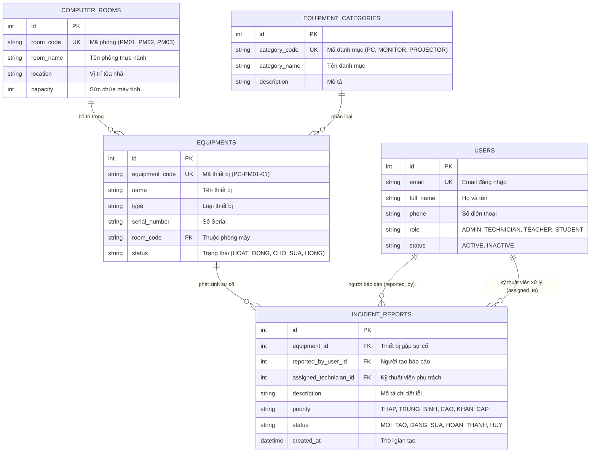
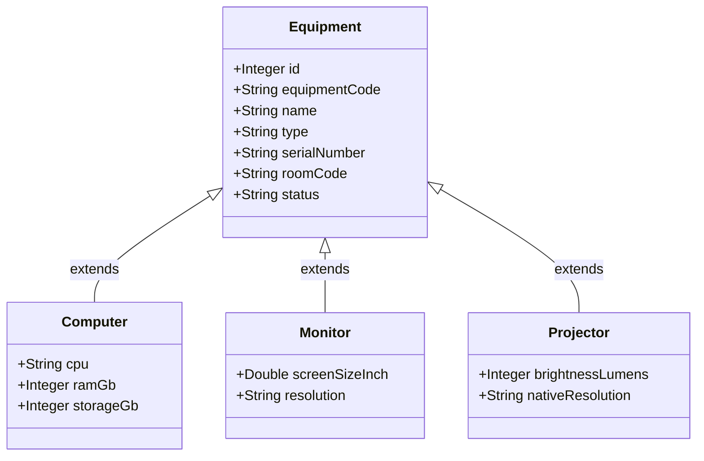

# LabRepair - Hệ Thống Quản Lý Thiết Bị Và Báo Cáo Sửa Chữa Phòng Máy

Đồ án môn học Lập trình Java - Khoa Công Nghệ Thông Tin, Trường Cao Đẳng Công Thương TP.HCM (HITC).

* **Sinh viên thực hiện:** Lê Nguyễn Ngọc Duy Anh
* **Mã số sinh viên (MSSV):** 2124110340
* **Lớp:** CCQ2411E
* **Giảng viên hướng dẫn:** ThS. Nguyễn Minh Tuấn

---

## 1. Giới thiệu đề tài

Hệ thống **LabRepair** được xây dựng nhằm giải quyết bài toán quản lý tài sản, trang thiết bị và xử lý sự cố kỹ thuật tại các phòng máy tính thực hành (PM01, PM02, PM03). Hệ thống áp dụng mô hình phân tách độc lập (Client-Server Decoupled) giữa Backend RESTful API và Frontend Single Page Application (SPA):

* **Cổng Người Dùng (`/`):** Dành cho sinh viên và giảng viên xem trực quan sơ đồ phòng máy, kiểm tra cấu hình máy trạm, gửi phiếu báo hỏng sự cố nhanh chóng và theo dõi tiến độ sửa chữa.
* **Cổng Quản Trị Hệ Thống (`/admin`):** Dành cho quản trị viên và kỹ thuật viên tiếp nhận sự cố, điều phối sửa chữa, quản lý danh mục thiết bị, phòng máy, quản lý tài khoản và quản lý kho linh kiện (hỗ trợ tự động trừ kho khi thay thế vật tư).

---

## 2. Công nghệ sử dụng

* **Backend:** Java 21 LTS, Spring Boot 3.4.x, Spring Data JPA, Hibernate.
* **Bảo mật:** Spring Security 6, JJWT 0.12.x (JSON Web Token), BCrypt Password Encoder.
* **Cơ sở dữ liệu:** MySQL 8.0 (kết nối qua XAMPP / Laragon).
* **Frontend:** React 19, Vite, Tailwind CSS, Lucide React, Axios.
* **Kiểm thử:** Postman Collection (`docs/LabRepair_Postman_Collection.json`), JUnit 5.

---

## 3. Sơ đồ cơ sở dữ liệu (ERD)



### Sơ đồ kế thừa thiết bị (OOP Inheritance)



---

## 4. Cấu trúc dự án

```text
labrepair/
├── docs/                       # Sơ đồ thiết kế (ERD, UML) và Postman Collection
│   ├── domain-model.puml       # Sơ đồ kế thừa thiết bị UML
│   ├── erd.mmd                 # Sơ đồ quan hệ thực thể ERD
│   └── LabRepair_Postman_Collection.json
├── src/                        # Mã nguồn Backend Spring Boot
│   ├── main/
│   │   ├── java/com/labrepair/labrepair/
│   │   │   ├── config/         # SecurityConfig, CorsConfig, DataInitializer
│   │   │   ├── controller/     # REST Controllers tiếp nhận request
│   │   │   ├── dto/            # Data Transfer Objects
│   │   │   ├── exception/      # Bắt lỗi toàn cục GlobalExceptionHandler
│   │   │   ├── model/          # Các JPA Entities (User, Equipment, Room...)
│   │   │   ├── repository/     # Spring Data JPA Repositories
│   │   │   ├── security/       # JwtAuthenticationFilter, JwtService
│   │   │   └── service/        # Nghiệp vụ hệ thống và tự động trừ kho
│   │   └── resources/
│   │       └── application.properties # Cấu hình cổng 8080, MySQL, JWT
│   └── test/                   # Kiểm thử tự động JUnit
├── frontend/                   # Mã nguồn Frontend React 19 SPA
│   ├── src/
│   │   ├── api/                # Axios Client cấu hình JWT Interceptor
│   │   ├── components/         # AdminLayout, HeaderClient, ProtectedRoute
│   │   ├── context/            # AuthContext (quản lý phiên đăng nhập và phân quyền)
│   │   ├── pages/              # Cổng Người Dùng (Sơ đồ phòng máy & Báo hỏng)
│   │   └── pages/admin/        # Cổng Quản Trị (Dashboard, Thiết bị, Kho vật tư...)
│   ├── package.json
│   └── vite.config.js          # Cấu hình Vite cổng 5173
└── pom.xml                     # Cấu hình dependencies Maven
```

---

## 5. Hướng dẫn cài đặt và khởi chạy

### Yêu cầu môi trường
* Java Development Kit (JDK) 17 hoặc 21.
* MySQL 8.0+ (khởi động qua XAMPP hoặc Laragon).
* Node.js 18+ và npm.

### Bước 1: Khởi động Cơ sở dữ liệu
1. Mở XAMPP hoặc Laragon, nhấn **Start** dịch vụ MySQL (cổng mặc định `3306`).
2. Mở phpMyAdmin (hoặc MySQL Workbench), tạo database mới:
   ```sql
   CREATE DATABASE labrepair_db CHARACTER SET utf8mb4 COLLATE utf8mb4_unicode_ci;
   ```
3. Kiểm tra thông tin kết nối trong `src/main/resources/application.properties`:
   ```properties
   spring.datasource.url=jdbc:mysql://localhost:3306/labrepair_db?useSSL=false&allowPublicKeyRetrieval=true&serverTimezone=UTC
   spring.datasource.username=root
   spring.datasource.password=
   ```

### Bước 2: Chạy Backend Spring Boot (Cổng 8080)
* **Cách 1 (Chạy qua IDE - khuyến nghị):**
  Mở thư mục `labrepair` trong VS Code hoặc IntelliJ IDEA. Mở file `src/main/java/com/labrepair/labrepair/LabrepairApplication.java` và nhấn nút **Run** (Run Java).
* **Cách 2 (Chạy qua dòng lệnh):**
  ```bash
  # Windows:
  .\mvnw.cmd spring-boot:run

  # Linux / macOS:
  ./mvnw spring-boot:run
  ```
Backend sẽ khởi chạy và sẵn sàng nhận request tại: `http://localhost:8080/api`

### Bước 3: Chạy Frontend React (Cổng 5173)
Mở một cửa sổ Terminal mới:
```bash
cd frontend
npm install
npm run dev
```
Trình duyệt sẽ mở giao diện tại: `http://localhost:5173`

---

## 6. Phân hệ và tài khoản thử nghiệm

Hệ thống hoạt động thống nhất trên cổng `5173` và phân tách bằng đường dẫn:

1. **Cổng Người Dùng (Sinh viên & Giảng viên):** `http://localhost:5173/`
   * Xem trực quan tình trạng các phòng máy PM01, PM02, PM03.
   * Click vào máy tính xem cấu hình và bấm gửi phiếu báo hỏng sự cố.
2. **Cổng Quản Trị Hệ Thống (CMS Admin):** `http://localhost:5173/admin`
   * Được bảo vệ bởi lớp chắn `ProtectedRoute`. Nếu chưa đăng nhập hoặc đăng nhập bằng tài khoản Sinh viên, hệ thống sẽ tự động chuyển hướng về trang đăng nhập `/login`.
   * Trang bị Dashboard chi phí, CRUD thiết bị, phòng máy, tiếp nhận sự cố và trừ tồn kho linh kiện tự động.

### Danh sách tài khoản thử nghiệm mẫu (Seed Data):

| Vai trò | Email đăng nhập | Mật khẩu | Quyền hạn |
| :--- | :--- | :---: | :--- |
| **Kỹ thuật viên (Technician)** | `tech@school.edu` | `tech123` | Quản lý sự cố, sửa chữa thiết bị, xuất linh kiện từ kho. |
| **Quản trị viên (Admin)** | `admin@school.edu` | `admin123` | Toàn quyền hệ thống `/admin`, quản lý tài khoản, thiết bị. |
| **Sinh viên (Student)** | `student@school.edu` | `student123` | Xem sơ đồ máy trạm, gửi báo hỏng, bị chặn khi vào `/admin`. |

---

## 7. Danh mục API Endpoints chính

* `POST /api/auth/login` - Đăng nhập hệ thống và lấy JWT Token.
* `POST /api/auth/register` - Đăng ký tài khoản người dùng mới.
* `GET /api/rooms` - Danh sách phòng máy thực hành.
* `POST /api/rooms` - Thêm mới phòng máy (Admin).
* `GET /api/equipments` - Danh sách thiết bị và cấu hình máy tính.
* `POST /api/equipments` - Thêm mới thiết bị (Admin).
* `PUT /api/equipments/{id}` - Cập nhật thông tin thiết bị.
* `DELETE /api/equipments/{id}` - Xóa thiết bị.
* `GET /api/incidents` - Danh sách phiếu báo hỏng sự cố.
* `POST /api/incidents` - Tạo mới phiếu báo hỏng sự cố.
* `POST /api/incidents/{id}/repair` - Kỹ thuật viên nghiệm thu sửa chữa và tự động trừ kho linh kiện.
* `GET /api/spare-parts` - Quản lý tồn kho linh kiện và cảnh báo sắp hết hàng.
