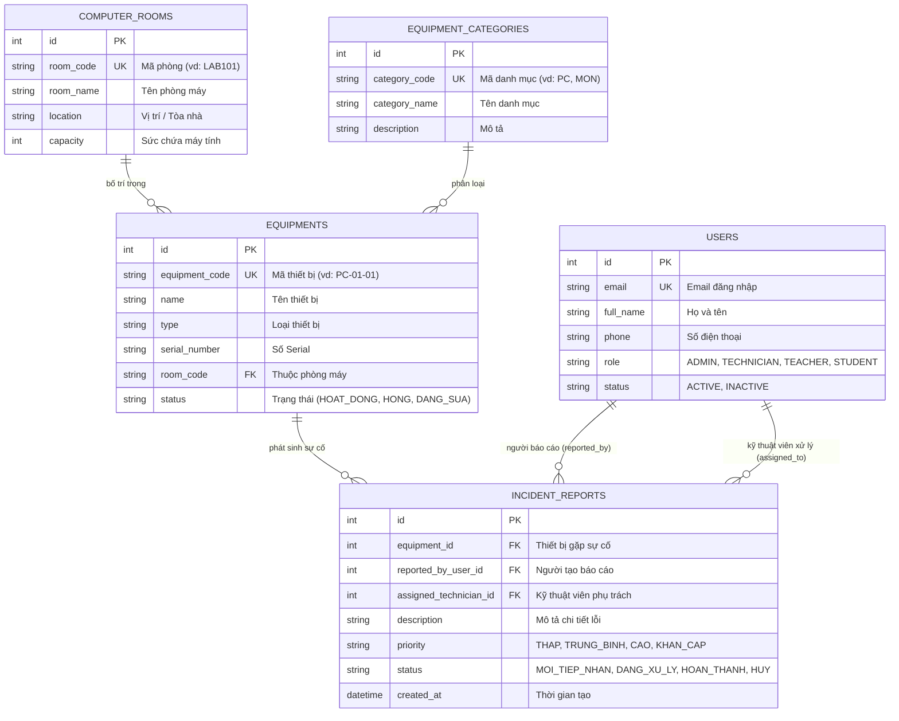
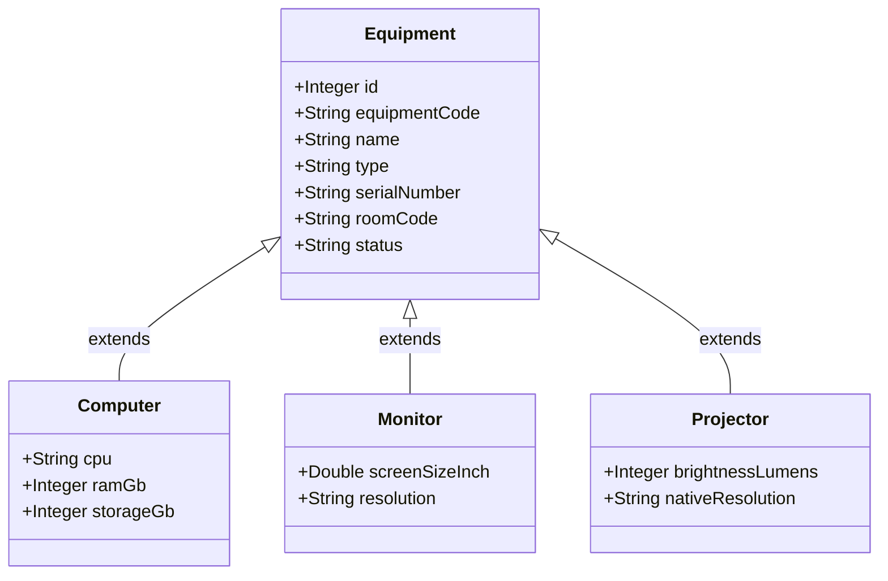

# 🛠️ LabRepair - Hệ Thống Quản Lý & Báo Cáo Sửa Chữa Thiết Bị Phòng Máy

> Dự án xây dựng Backend RESTful API phục vụ quản lý thiết bị phòng máy thực hành, theo dõi tình trạng hư hỏng và điều phối kỹ thuật viên sửa chữa sự cố.

---

## 📌 1. Giới thiệu dự án

Hệ thống **LabRepair** giải quyết bài toán quản lý tài sản, trang thiết bị tại các phòng máy thực hành (trường học, trung tâm đào tạo, văn phòng). Khi thiết bị (máy tính, màn hình, máy chiếu...) gặp trục trặc, giảng viên hoặc sinh viên có thể tạo báo cáo sự cố. Hệ thống hỗ trợ bộ phận quản trị tiếp nhận, phân công kỹ thuật viên xử lý và cập nhật tiến độ minh bạch.

---

## 📅 2. Kế hoạch thực hiện từng tuần (4 Tuần) & Tiến độ dự án

> Kế hoạch 4 tuần rút gọn bám sát mục tiêu xây dựng và hoàn thiện hệ thống Backend:

| Tuần | Công việc chính | Kết quả cần có (Deliverables) | Tiến độ | Trạng thái |
| :---: | :--- | :--- | :---: | :---: |
| **Tuần 1** | **Khảo sát yêu cầu, Thiết kế hệ thống & Khởi tạo dự án**<br>- Chốt đề tài, phân tích vai trò người dùng (Admin, Technician, Teacher, Student).<br>- Thiết kế mô hình CSDL (ERD) và quan hệ kế thừa (Equipment, Computer, Monitor, Projector).<br>- Khởi tạo Spring Boot 3, cấu hình Maven, kết nối MySQL và Hibernate ddl-auto. | - Sơ đồ ERD (`erd.mmd` / Mermaid)<br>- Domain Model UML kế thừa<br>- Project skeleton kết nối MySQL thành công | **100%** |  Hoàn thành |
| **Tuần 2** | **Xây dựng thực thể cơ sở & CRUD các tài nguyên chính**<br>- Thiết kế Entity, Repository, Service, Controller cho `Equipment`, `ComputerRoom`, `EquipmentCategory`, `User`.<br>- Triển khai đầy đủ các phương thức GET, POST, PUT, DELETE.<br>- Cấu hình lưu trữ dữ liệu bền vững trên MySQL qua Spring Data JPA. | - API CRUD Phòng máy (`/api/rooms`)<br>- API CRUD Danh mục (`/api/categories`)<br>- API CRUD Thiết bị (`/api/equipments`)<br>- API CRUD Người dùng (`/api/users`) | **100%** |  Hoàn thành |
| **Tuần 3** | **Xử lý nghiệp vụ Báo cáo sự cố & Bắt lỗi tập trung**<br>- Xây dựng module `IncidentReport`: Tạo phiếu báo hỏng, phân công kỹ thuật viên.<br>- Luồng chuyển đổi trạng thái: `MOI_TIEP_NHAN` -> `DANG_XU_LY` -> `HOAN_THANH` / `HUY`.<br>- Xây dựng bộ bắt lỗi tập trung `GlobalExceptionHandler` (chặn trùng mã, bắt NotFound, validate dữ liệu). | - API Báo cáo & điều phối sự cố (`/api/incidents`)<br>- Chuẩn hóa định dạng lỗi `ErrorResponse`<br>- Xử lý ngoại lệ `DuplicateResource`, `ResourceNotFound`, `BadRequest` | **100%** |  Hoàn thành |
| **Tuần 4** | **Kiểm thử toàn diện, Hoàn thiện tài liệu & Báo cáo**<br>- Kiểm thử toàn bộ API bằng Postman (kiểm tra các ca thành công và biên lỗi).<br>- Xuất file Postman Collection lưu vào thư mục `docs/`.<br>- Hoàn thiện Cổng Người Dùng (FE `/`) và Cổng Quản Trị Backend (CMS `/admin`) với Auth Guard.<br>- Hoàn thiện tài liệu `README.md`, đẩy toàn bộ mã nguồn lên GitHub. | - Postman Collection & Test Case đầy đủ<br>- Hệ thống Web hoàn chỉnh 2 phân hệ (/ và /admin)<br>- GitHub repository chuẩn chỉ, sẵn sàng nộp | **100%** |  Hoàn thành |

---

## 🗄️ 3. Sơ đồ thực thể CSDL (Entity Relationship Diagram - ERD)

Dưới đây là sơ đồ quan hệ giữa các bảng trong cơ sở dữ liệu `labrepair_db`:



### 🧬 Sơ đồ lớp kế thừa thiết bị (UML Class Diagram)

Hệ thống áp dụng tính kế thừa hướng đối tượng cho các loại thiết bị:



> 📂 File thiết kế gốc đã được lưu sẵn trong thư mục [docs/](docs/):
> - Sơ đồ ERD: [`docs/erd.mmd`](docs/erd.mmd)
> - Sơ đồ UML: [`docs/domain-model.puml`](docs/domain-model.puml)

---

## 🚀 4. Hướng dẫn cài đặt và chạy thử

### Yêu cầu môi trường
* **Java:** JDK 17 trở lên
* **Build tool:** Apache Maven 3.8+ (hoặc dùng `./mvnw` có sẵn trong source)
* **Database:** MySQL 8.0+

### Các bước khởi chạy
1. **Clone repository:**
   ```bash
   git clone <URL_REPO_GITHUB_CUA_BAN>
   cd labrepair
   ```

2. **Cấu hình cơ sở dữ liệu:**
   - Mở MySQL và tạo một database mới:
     ```sql
     CREATE DATABASE labrepair_db CHARACTER SET utf8mb4 COLLATE utf8mb4_unicode_ci;
     ```
   - Kiểm tra file `src/main/resources/application.properties` để chắc chắn thông tin đăng nhập khớp với MySQL máy bạn:
     ```properties
     spring.datasource.url=jdbc:mysql://localhost:3306/labrepair_db?useSSL=false&allowPublicKeyRetrieval=true&serverTimezone=UTC
     spring.datasource.username=root
     spring.datasource.password=
     ```

3. **Khởi chạy ứng dụng:**
   - Sử dụng Maven Wrapper:
     ```bash
     # Trên Windows:
     .\mvnw.cmd spring-boot:run

     # Trên Linux / macOS:
     ./mvnw spring-boot:run
     ```
   - Ứng dụng sẽ chạy tại: `http://localhost:8080`

---

## 📡 5. Danh sách RESTful API Endpoints

### 🏢 Phòng máy (`/api/rooms`)
- `GET /api/rooms` - Lấy danh sách tất cả các phòng máy.
- `GET /api/rooms/{id}` - Xem thông tin chi tiết một phòng máy.
- `POST /api/rooms` - Thêm mới một phòng máy.
- `PUT /api/rooms/{id}` - Cập nhật thông tin phòng máy.
- `DELETE /api/rooms/{id}` - Xóa phòng máy.

### 🏷️ Danh mục thiết bị (`/api/categories`)
- `GET /api/categories` - Danh sách danh mục.
- `GET /api/categories/{id}` - Chi tiết danh mục.
- `POST /api/categories` - Tạo danh mục mới.
- `PUT /api/categories/{id}` - Sửa danh mục.
- `DELETE /api/categories/{id}` - Xóa danh mục.

### 🖥️ Quản lý thiết bị (`/api/equipments`)
- `GET /api/equipments` - Lấy danh sách tất cả thiết bị.
- `GET /api/equipments/{id}` - Chi tiết thiết bị.
- `POST /api/equipments` - Thêm thiết bị mới vào hệ thống.
- `PUT /api/equipments/{id}` - Cập nhật thông tin thiết bị.
- `DELETE /api/equipments/{id}` - Xóa thiết bị khỏi hệ thống.

### 👥 Người dùng (`/api/users`)
- `GET /api/users` - Danh sách người dùng.
- `GET /api/users/{id}` - Chi tiết người dùng.
- `POST /api/users` - Tạo người dùng mới.
- `PUT /api/users/{id}` - Cập nhật thông tin người dùng.
- `DELETE /api/users/{id}` - Xóa người dùng.

### ⚠️ Báo cáo sự cố (`/api/incidents`)
- `GET /api/incidents` - Danh sách tất cả các sự cố được báo cáo.
- `GET /api/incidents/{id}` - Chi tiết sự cố.
- `POST /api/incidents` - Tạo mới báo cáo sự cố (giảng viên/sinh viên tạo).
- `PUT /api/incidents/{id}` - Cập nhật thông tin/trạng thái sự cố (kỹ thuật viên xử lý).
- `DELETE /api/incidents/{id}` - Xóa bản ghi sự cố.

---

## 📁 6. Cấu trúc thư mục dự án

```text
labrepair/
├── docs/                       # Tài liệu thiết kế, sơ đồ, Postman collection
├── src/
│   ├── main/
│   │   ├── java/com/labrepair/labrepair/
│   │   │   ├── controller/     # Tiếp nhận HTTP Request và điều phối luồng
│   │   │   ├── service/        # Chứa Business Logic (nghiệp vụ hệ thống)
│   │   │   ├── repository/     # Tương tác với CSDL qua Spring Data JPA
│   │   │   ├── model/          # Định nghĩa các Entity JPA
│   │   │   └── exception/      # Bắt lỗi toàn cục & chuẩn hóa định dạng lỗi
│   │   └── resources/
│   │       └── application.properties # Cấu hình DB, Port, Hibernate
│   └── test/                   # Unit test & Integration test
├── pom.xml                     # Khai báo dependency Maven
└── README.md                   # Tài liệu tổng quan dự án
```


---

## 🎨 7. Kiến Trúc Phân Hệ Web Frontend (Tách Biệt / và /admin)

Giao diện được xây dựng bằng **React 19 + Vite 6 + Tailwind CSS**, phân tách rõ ràng 2 phân hệ độc lập qua React Router DOM trên cổng `http://localhost:5173`:

### 🌐 Phân Hệ 1: Cổng Người Dùng (Client Portal - URL: `/`)
- **Đối tượng:** Sinh viên & Giảng viên trường HITC.
- **Phong cách:** iOS Frosted Glass (Trắng Tinh Khiết & Aqua Blue).
- **Chức năng:**
  - Xem trực quan sơ đồ phòng máy thực hành (PM01, PM02, PM03).
  - Click vào từng máy trạm để xem cấu hình phần cứng (CPU, RAM, VGA, Màn hình).
  - Nút **"Gửi Báo Hỏng Máy"** trực tiếp gửi thông tin sự cố đến Kỹ thuật viên.
  - Theo dõi tiến độ xử lý phiếu báo hỏng (Mới tạo -> Đang sửa -> Đã sửa xong).
- **Bảo mật:** Không hiển thị bất kỳ tính năng quản trị, giá tiền linh kiện hay chức năng xóa sửa phòng máy.

### 🛡️ Phân Hệ 2: Cổng Quản Trị Hệ Thống (Back-Office CMS - URL: `/admin`)
- **Đối tượng:** Ban Quản Trị (Admin) & Kỹ Thuật Viên (Technician).
- **Phong cách:** Dark Enterprise EzyPlatform Sidebar.
- **Bảo mật (Auth Guard - `ProtectedRoute`):** Người dùng chưa đăng nhập hoặc có vai trò Sinh viên (`STUDENT`) khi vào `/admin` sẽ bị **chặn 100%** và chuyển hướng về `/login`.
- **Tài khoản đăng nhập quản trị:**
  - 👑 **Quản trị viên (Admin):** `admin@school.edu` / `admin123`
  - 🔧 **Kỹ thuật viên (Technician):** `tech@school.edu` / `tech123`
- **Chức năng:**
  1. **Dashboard:** Thống kê tổng số thiết bị, tỷ lệ máy hoạt động, số sự cố đang xử lý và tổng chi phí lũy kế.
  2. **Quản lý Thiết bị (Equipments):** CRUD thông tin máy tính, số serial, cấu hình, phòng máy.
  3. **Quản lý Phòng máy (Rooms):** CRUD phòng thực hành, sức chứa, vị trí tòa nhà.
  4. **Phiếu Sự cố & Sửa chữa (Incidents):** Tiếp nhận sự cố từ sinh viên, điều phối kỹ thuật viên, nghiệm thu sửa chữa.
  5. **Kho Linh kiện & Vật tư (Spare Parts):** Quản lý định mức tồn kho an toàn, cảnh báo sắp hết hàng và **tự động trừ kho** khi thay linh kiện vào máy.
  6. **Quản lý Người dùng (Users):** Danh sách tài khoản, phân quyền RBAC (`ADMIN`, `TECHNICIAN`, `TEACHER`, `STUDENT`).
  7. **Cài đặt Hệ thống (Settings):** Cấu hình RESTful API Spring Boot (`8080`) & MySQL Database (`3306`).

---

## 🚀 8. Hướng Dẫn Khởi Chạy 1-Click Cực Nhanh

Trong thư mục gốc `D:\labrepair`, bạn chỉ cần chạy:
- **`CHAY_TAT_CA.bat`**: Tự động bật đồng thời cả Backend Spring Boot (cổng `8080`) và Frontend React (cổng `5173`).
- Hoặc mở riêng:
  - `CHAY_BACKEND.bat` $\rightarrow$ REST API Server tại `http://localhost:8080/api`
  - `CHAY_FRONTEND.bat` $\rightarrow$ Web App tại `http://localhost:5173`
